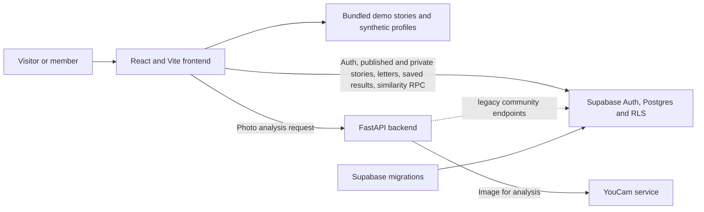

# ILLUMINATE

**Beyond the Reflection** is a skin confidence and supportive storytelling app. It includes a public Living Wall, optional AI skin analysis through YouCam, Supabase accounts and private member tools, and synthetic community statistics clearly labelled as demo data.

## What you need

- Node.js 18 or newer and npm
- Python 3.10 or newer
- A Supabase project for accounts and saved member content (optional for demo mode)
- A YouCam API key for live skin analysis (optional)

## Run locally

### Frontend

```sh
cd frontend
npm install
```

For local demo mode, start the frontend without environment variables:

```sh
npm run dev
```

To use Supabase, copy `frontend/.env.example` to `frontend/.env.local`, set the project URL and anon key, then start the dev server:

```sh
npm run dev
```

Vite serves the app at `http://localhost:5173` by default.

### Backend

In a second terminal:

```sh
cd backend
python -m venv .venv
# Windows PowerShell: .venv\Scripts\Activate.ps1
# macOS/Linux:       source .venv/bin/activate
python -m pip install -r requirements.txt
```

Copy `backend/.env.example` to `backend/.env` and add `YOUCAM_API_KEY` to enable skin analysis. Then run:

```sh
uvicorn app.main:app --reload --port 8000
```

The health check is at `http://localhost:8000/api/health`. The backend currently provides the skin analysis API and legacy community endpoints; the main app's public stories, authentication, and member data use Supabase directly.

## Supabase setup (optional)

1. Create a Supabase project.
2. Apply the SQL files in `supabase/migrations/` in filename order, using the Supabase CLI or SQL editor.
3. Enable Email under Authentication providers.
4. Set `VITE_SUPABASE_URL` and `VITE_SUPABASE_ANON_KEY` in `frontend/.env.local`.

The frontend anon key is designed to be public and database access is controlled by row-level security (RLS). **Never put a Supabase service-role key in frontend code or a `VITE_*` variable.** The optional server-side service-role settings in `backend/.env.example` are for legacy community endpoints only.

## Demo mode and data

Without Supabase settings, the public experience runs from bundled sample data. Sign-in and account features are unavailable in this mode. The Living Wall stories and community similarity figures are synthetic examples, not real member submissions or population statistics. The similarity score is calculated from a deterministic set of 120 fabricated profiles, of which 100 are eligible for the calculation.

Skin photos are sent to YouCam for analysis when that feature is configured. Illuminate does not save the uploaded photo. If users choose to save analysis results to their account, only parsed result data is stored.

## App routes

- `/` - The Living Wall
- `/skin-without-shame` - Skin analysis and supportive content
- `/time-machine` - Personal reflection; signed-in users are directed to their saved area
- `/messages` - Supportive messages
- `/login` - Sign in or register when Supabase is configured
- `/dashboard/stories`, `/dashboard/time-machine`, `/dashboard/skin`, `/dashboard/settings` - Sign-in required

## Architecture

Open the [interactive architecture map](docs/architecture.html) in a browser to pan, zoom, and expand each component for its responsibilities and data flow. It is a self-contained file with no external libraries. GitHub shows the source file rather than running interactive HTML; the overview below is readable directly in this README.



The browser talks directly to Supabase for authentication and member data; database policies enforce access. Skin photos go from the browser through FastAPI to YouCam and are not stored by Illuminate. If Supabase is not configured, public demo content and similarity results come from the frontend bundle. The backend's Supabase service-role configuration belongs only on the server and is used by legacy community endpoints.

## Project layout

```text
backend/    FastAPI service, YouCam integration, and Python tests
frontend/   React and Vite app, static assets, and JavaScript tests
supabase/   Database migrations and SQL tests
scripts/    Deterministic demo data and SQL seed generator
```

The Supabase project folder is at the repository root so the Supabase CLI can use its standard location.

## Tests and build

```sh
cd frontend
npm test
npm run build
```

```sh
cd backend
python -m pytest
```

The SQL tests under `supabase/tests/` require a local PostgreSQL/Supabase-compatible test setup and the command-line tools documented by their runner scripts.

## Generate the demo seed

From the repository root:

```sh
python scripts/generate_seed.py
```

This deterministically regenerates the synthetic community data JSON and its SQL seed migration.
